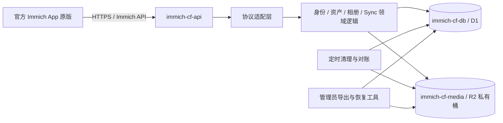

# immich-cf 完整需求文档

> 文档版本：1.0（需求与可行性验证基线）\
> 核实日期：2026-10-13，Asia/Shanghai\
> 项目名称：`immich-cf`\
> 状态：允许进入兼容性 PoC；尚未证明可作为可靠照片备份服务发布。\
> 本文记录需求基线制定时的状态；后续已完成开发环境骨架部署，尚未完成官方 App 真机兼容性测试。\
> 2026-10-13 P0 补充：[契约调查与版本冻结报告](../docs/p0-report.md)。v3.3.1 源码契约已冻结，iOS 3.3.1 build 23 已由用户确认，安装构建独立核验与运行验证仍待完成；本文中的未验证项须结合该报告阅读。

## 1. 决策摘要与证据边界

### 1.1 产品方向

`immich-cf` 是面向个人、小规模家庭使用的照片备份与浏览服务。服务端优先采用 Cloudflare Workers、D1、R2，接入完全未修改的官方 Immich 移动 App。先验证协议与基础照片闭环，再决定是否投入完整 MVP。

本项目是独立实现兼容服务端，不预设能将完整 Immich 服务端原样运行于 Workers，也不以“能够登录”作为“兼容 Immich”的证明。

### 1.2 已确认的用户要求

| 编号 | 要求 | 决策性质 |
| --- | --- | --- |
| H-01 | 官方 Immich App 完全不修改 | 不可通过开发定制 App、重新打包或客户端补丁绕过 |
| H-02 | 优先 Cloudflare 有免费额度的产品，核心为 Workers / D1 / R2 | 免费额度优先，不等于承诺任何规模下永久零费用 |
| H-03 | 允许不支持大文件上传 | 可以限制单文件大小，但不能把拒绝的文件标记为备份成功 |
| H-04 | 项目及资源统一以 `immich-cf` 命名 | 用途采用后缀区分；生产不加环境后缀，开发和验收分别加 `-dev`、`-staging` |
| H-05 | 先形成需求，再分阶段开发 | 每阶段必须有依赖、交付证据和退出标准 |

### 1.3 原对话可恢复程度

已读取引用对话“需求分析 Cloudflare相册”。其中用户消息可读，确认了上述方向；历史助手消息仅返回内容引用占位符，未能恢复技术分析正文。因此，本文件不声称复现了所有历史结论。具体架构、初始容量、文件上限、阶段工期均是本文件提出的项目基线，可依据 PoC 证据调整。

证据标记定义：

- **已核实—资料/源码**：本次查看了官方文档或固定版本源码；不代表已在目标账户或真机上运行。
- **项目要求**：实施时必须满足的目标与约束。
- **设计建议**：推荐实现方式，允许通过架构决策记录调整。
- **待验证**：目前缺少运行证据；不能写入已支持功能清单。

### 1.4 当前 Go/No-Go

**Go：进入 P0～P2 的有界验证。No-Go：立即宣称完整兼容、直接迁入唯一照片副本或发布稳定版本。**

最先验证的四个问题是：官方 App 能否完成会话和同步；Free Workers 能否承载真实上传与初次同步；支持格式的预览如何生成；大文件被拒绝后是否阻塞正常备份。任何一个关键问题失败，都必须在扩大开发前做出范围或预算决策。

## 2. 用户、场景、范围与非目标

### 2.1 目标用户与规模

首期采用“每部署一个个人图库”的模式，可有多个设备会话。数据库从第一天保留用户归属字段，并用两个测试账户验证隔离；公开注册、多租户运营和家庭共享不是首期发布范围。

初始验证负载为：1 个实际用户、2 台设备、1,000 张真实测试照片、总对象体积不超过项目设定的 8 GB 软预算。另准备 10,000 条合成元数据测试同步与索引，不要求同时上传 10,000 张真实图片。以上是测试规模与产品建议，不是平台承诺。

核心用户路径：

1. 在官方 App 中填写服务地址并登录。
2. 选择手机相册进行备份；已备份文件不重复创建。
3. 上传完成后在另一设备看到照片、时间线和详细信息。
4. 打开预览、下载原图；原图字节与上传源一致。
5. 收藏、加入个人相册、删除至回收站和恢复。
6. 网络恢复或 App 重启后继续同步，不丢照片、不出现永久幽灵记录。

### 2.2 功能范围

| 编号 | 功能 | 优先级 | 发布标准 |
| --- | --- | --- | --- |
| FR-01 | 服务发现、版本和能力响应 | P0 | 官方 App 可连接；能力响应与实际实现一致 |
| FR-02 | 密码登录、会话保持、退出与撤销 | P0 | 重启恢复会话；撤销后不能访问媒体 |
| FR-03 | 限额内照片备份与重复检测 | P0 | JPEG、PNG 测试集完整上传；重试不重复计费或创建资产 |
| FR-04 | Sync V2 首次、增量、恢复、删除同步 | P0 | 两设备最终一致，正确处理 ACK 与重置 |
| FR-05 | 时间线、详情、预览、原图下载 | P0 | 日期排序和方向正确；无永久占位图 |
| FR-06 | 收藏与个人相册管理 | P1，MVP 必须 | 跨设备同步；删除相册不误删照片 |
| FR-07 | 回收站、恢复和永久删除 | P1，MVP 必须 | 原图、衍生图、关系与同步记录可对账 |
| FR-08 | 配额、支持范围与错误说明 | P0 | 不虚报备份成功；可定位失败原因 |
| FR-09 | 备份导出、恢复与运维状态 | P1，试用前必须 | 完成一次隔离环境恢复演练 |
| FR-10 | HEIC/HEIF 与小视频 | 条件支持 | 逐格式、逐系统验收后才能列为支持 |

JPEG/PNG 是最小 PoC 格式。iPhone 实际图库常见格式能否处理，必须纳入 P2 评估；不能仅凭 JPEG 通过就宣传“完整支持 iPhone 照片备份”。发布时应列出确切支持的格式、大小、客户端版本和系统版本。

### 2.3 非目标

- 不承诺官方 Immich 全功能、所有历史版本或所有未来 App 自动兼容。
- 不修改官方 App 的 UI、上传协议、重试逻辑、同步数据库或证书校验。
- 不实现大文件分片上传扩展，不要求 App 使用自定义 R2 预签名直传流程。
- 首期不实现人脸识别、语义搜索、OCR、自动回忆、在线编辑、地图服务、转码和机器学习。
- 首期不实现共享链接、伙伴共享、共享相册、公开注册、商业多租户、支付计费。
- 不完整复刻官方 Web 前端；可提供简单的部署说明和管理员状态页。
- 不承诺 Live Photo、RAW、HDR、动态照片、侧车文件和复杂视频格式；未验收前不得静默丢弃配套数据后宣称完整备份。
- 不将 R2 当成独立备份策略，也不承诺免费额度下的服务等级协议。

非目标功能仍可能被官方 App 在初始化或页面进入时调用。必须通过能力声明、真实空结果或兼容的明确拒绝实现安全降级。只有“确实没有数据”的只读集合才能返回空集合；未实现的写操作绝不能返回假成功。若 App 不能容忍某项非目标功能缺失，则将最小必要实现提升为兼容性依赖，或作出 No-Go。

## 3. 官方 App 不修改的兼容性硬约束

### 3.1 允许与禁止

允许用户使用官方设置填写服务器地址、登录和选择备份相册。开发期间可以阅读官方源码、运行参考服务端、收集测试账户流量和使用独立协议测试程序。

禁止要求用户安装自编译 App、修改安装包、替换 SDK、注入脚本、更改请求体或在手机侧运行适配代理。最终验收必须使用官方发行的原始二进制。开发调试工具可以辅助取证，但不能成为日常使用依赖。

### 3.2 版本基线

2026-10-13 核实时，官方 GitHub `releases/latest` 指向 **v3.3.1**。这仅确认仓库发行版，不证明 Android/iOS 商店在所有地区提供相同版本和构建号。[来源 S1](https://github.com/immich-app/immich/releases/tag/v3.3.1)

P0 必须创建版本清单，记录：Android/iOS App 版本、构建号、发行渠道、系统版本；参考服务端镜像摘要；源码 tag 与完整 commit SHA；OpenAPI 文件摘要；`immich-cf` 自身版本、数据库迁移版本和 Workers compatibility date。无法取得的字段写“待取得”，不得补造。

第一轮只支持经测试的明确客户端版本组合。升级任一客户端前重跑契约和关键真机路径。项目可以暴露兼容协议版本供 App 协商，同时用独立元数据记录 `immich-cf` 的实现版本；不得仅修改版本数字来绕过实际不兼容，也不得冒充官方服务。

### 3.3 兼容性定义

兼容性包含 HTTP 路径、方法、鉴权、状态码、请求和响应字段、枚举、空值、日期格式、分页、二进制媒体、同步事件和错误行为。客户端显示成功但服务端未持久化，仍判定失败。

必须验证客户端启动调用的完整依赖链，包括能力配置、用户偏好、存储统计、重复检测、媒体加载和可能的实时通知。不能假定提供“登录、上传、列表”三个接口即可运行官方 App。WebSocket 或其他通知机制是否属于所选 App 的硬依赖，列为 P0 调查项。

## 4. 当前技术事实与 Cloudflare 预算

### 4.1 已核实的平台数字

| 产品 | 本次官方资料所列关键免费限额 | 影响 |
| --- | --- | --- |
| Workers Free | 100,000 请求/日；CPU 10 ms/调用；内存 128 MB | 上传解析、密码校验、哈希、序列化和图片处理都需要测量 CPU |
| Cloudflare Free 请求体 | 最大 100 MB；取决于 Cloudflare 账户计划，而非 Workers 付费档 | 包含 multipart 开销；不是单文件可用容量承诺 |
| D1 Free | 5,000,000 行读/日；100,000 行写/日；账户总存储 5 GB | 行扫描和索引写入消耗额度，不能按接口次数估算 |
| D1 Free 单库 | 500 MB；账户最多 10 库；每 Worker 调用最多 50 个查询 | 不能把账户 5 GB 当成单库容量 |
| D1 其他约束 | 每 SQL 最多 100 个绑定参数；单行/字符串/BLOB 最大 2 MB | ACK 与批量操作需分批；照片二进制放 R2 |
| R2 Standard | 10 GB-month/月；Class A 100 万次/月；Class B 1,000 万次/月；互联网出站流量免费 | 原图、缩略图、临时对象和备份均计存储；操作仍可能计费 |

Workers 数值及请求体说明见 [S2](https://developers.cloudflare.com/workers/platform/limits/)。D1 读写定价见 [S3](https://developers.cloudflare.com/d1/platform/pricing/)，容量与查询约束见 [S4](https://developers.cloudflare.com/d1/platform/limits/)。R2 免费额度仅适用于 Standard，见 [S5](https://developers.cloudflare.com/r2/pricing/)。平台限额会变化，部署前须重新检查目标账户。

CPU 时间与网络等待的墙钟时间不同。流式读写有助于减少内存占用，但不会免除解析、哈希、数据库结果处理和编码所花费的 CPU，也不会突破一次调用的预算。

### 4.2 免费优先策略

设计默认使用 Workers Free + D1 Free + R2 Standard。付费 Workers、Images、Queues、Durable Objects、外部计算服务均不是默认隐藏依赖；需要引入时单独记录原因、费用和决策。R2 超过免费用量可以产生账单，不能把其免费额度当作自动硬停机阈值。

项目建议采用以下保守软预算，并计入同账户其他项目占用：

| 指标 | 初始告警值 | 初始保护动作 |
| --- | --- | --- |
| Workers 请求 | 日额度 70% / 85% | 告警；限制非必要管理查询和异常流量 |
| D1 读、写 | 日额度 70% / 85% | 告警；暂停非必要扫描/批处理，保护核心业务 |
| D1 单库 | 350 MB / 400 MB | 评估清理和迁移；禁止继续无界增长 |
| R2 当前对象总量 | 7 GB / 8 GB | 告警；在上传预留阶段拒绝新增写入 |
| R2 月操作量 | 免费额度 70% / 85% | 分析重试、读取与列表操作；限制异常请求 |

8 GB 是产品软预算，不是 R2 计费公式。R2 采用 GB-month，用量、版本、临时对象与操作请求可能存在延迟；应用保护只能降低超支概率，不能保证绝对零账单。生产前必须验证账户账单、告警与应用统计的差异。

D1 官方文档说明，免费日读写额度耗尽后查询会报错；每日 00:00 UTC 重置，即北京时间 08:00。不能假设超额后仅变慢。[来源 S3](https://developers.cloudflare.com/d1/platform/pricing/)

### 4.3 容量模型与验收负载

建议测量以下实际系数，不预填“每张照片固定几次请求”：

```text
R2 存储 ≈ 原图 + 预览/缩略图 + 回收站 + 未完成上传 + 导出备份
Worker 日请求 ≈ 登录/发现 + 上传/查重 + 媒体读取 + 同步/ACK + 重试 + 运维
D1 日写 ≈ 业务行 + 关系行 + 同步记录 + 检查点 + 索引维护 + 清理
D1 日读 ≈ 实际扫描行，不能用返回行数或 SQL 调用次数代替
```

示例假设：1,000 张照片，平均原图 4 MB，衍生图合计 0.2 MB/张，约占 4.2 GB 十进制容量，尚未计入临时对象、回收站和备份。这只是估算样例，不是照片大小事实。P5 用 R2/D1/Workers 的真实指标替换估算，并验证预期峰值两倍负载仍有合理余量。

## 5. API 契约发现与验证

### 5.1 证据顺序与产物

Immich 官方使用 OpenAPI 生成文档和客户端 SDK；生成物可以辅助提取字段，但无法代替移动端行为和同步协议验证。[来源 S6](https://docs.immich.app/api/)

P0 按以下顺序建立可复现契约：

1. 固定参考版本，归档 OpenAPI、服务端控制器/DTO、同步服务与序列化逻辑的摘要。
2. 阅读相同版本移动端的登录、备份、同步、媒体与错误处理调用路径。
3. 在官方参考服务端执行相同操作，采集脱敏请求、响应、同步行和最终用户可见状态。
4. 用相同夹具测试 `immich-cf`；除随机 ID、时间和部署地址等明确允许的差异外逐项比较。
5. 在官方 App 真机复跑；若 Schema 检查通过而 App 失败，以失败处理。

必须交付以下开发产物：`compatibility-manifest.json`、`api-contract-matrix.md`、`sync-contract.md`、脱敏 fixtures、自动化契约测试、Android/iOS 验收记录。以上是后续阶段产物名称，本次没有伪造这些验证文件。

### 5.2 API 覆盖矩阵

下表是调查和实现分组，不是已完成端点目录。除 6.1 已核实的 Sync 路由外，精确路径、方法及状态码均须从固定 OpenAPI、源码与实际调用补全。

| 分组 | 必须覆盖的行为 | 契约重点 | 阶段 |
| --- | --- | --- | --- |
| 服务信息 | 发现、ping、版本、能力、公共配置 | 地址是否包含 `/api`；默认字段；版本判断 | P0/P1 |
| 身份与会话 | 登录、当前用户、有效性、退出、撤销 | token 使用位置、Cookie、过期和错误体 | P1 |
| 用户与偏好 | 初始化用户信息、客户端必要偏好 | 必填/可空字段、未知枚举、配额字段 | P1 |
| 备份预检查 | 设备资产 ID、校验和、重复/已存在判定 | 编码与归属、重复返回格式、批量限制 | P2 |
| 资产上传 | multipart 文件与元数据 | 字段名、文件长度、媒体类型、日期、状态码 | P2 |
| 资产信息 | 详情、时间线所需元数据、计数 | 分页/顺序、时区、可见性、删除状态 | P2/P3 |
| 媒体 | thumbnail、preview、original、必要视频流 | Range、缓存、鉴权、内容类型和方向 | P2 |
| Sync V2 | stream、ACK 读取/写入/删除、reset | 流 framing、事件版本、会话隔离 | P1/P3 |
| 相册/收藏 | 相册 CRUD、关系增删、收藏 | 多项操作逐项结果、幂等和同步联动 | P4 |
| 删除/回收站 | 软删除、恢复、永久删除 | 删除事件、对象清理、重复操作 | P4 |
| 非目标依赖 | 搜索、人物、共享、统计、通知等 | 能否关闭；空态或错误是否阻断客户端 | P0 起持续验证 |

接口记录至少含：操作 ID、方法/路径、调用场景、鉴权、请求字段约束、响应必填与空值、成功/失败状态、幂等方式、关联同步事件、参考证据、实现状态和测试编号。

### 5.3 表单校验与错误提示

所有可控后端与管理页面遵循相同规则：指出字段名称、原因和可操作修正要求，不返回单一“校验失败”。多字段约束需要列出相关字段。禁止回显密码、令牌、私密联系方式的提交值。

内部领域错误建议使用以下结构，**这不是对 Immich 错误响应格式的断言**：

```json
{
  "code": "VALIDATION_ERROR",
  "message": "上传文件：最大支持 20 MiB，请选择更小的文件",
  "fields": [
    {
      "field": "assetData",
      "label": "上传文件",
      "reason": "FILE_TOO_LARGE",
      "requirement": "文件大小不得超过 20 MiB"
    }
  ],
  "requestId": "不包含秘密的请求标识"
}
```

协议适配层必须映射为目标 App 能解析的官方错误形状，在客户端实际展示的消息字段保留具体原因；扩展字段仅在确认被兼容接受后增加。字段错误与鉴权失败不同：密码登录失败不泄露账号是否存在。

官方 App 的 UI 无法由服务端完全控制。如果它把具体服务器错误隐藏为泛化提示，必须记录为兼容性缺陷，评估是否阻断备份；不得声称已满足具体提示要求。管理状态页可以补充诊断，但不能替代核心 App 流程验收。

## 6. Sync V2 专项契约

### 6.1 已核实的固定版本接口

在 v3.3.1 的 `sync.controller.ts` 中，控制器前缀为 `sync`，可核实如下路由。对外 `/api` 基址仍须随全局配置在 P0 验证。[来源 S7](https://raw.githubusercontent.com/immich-app/immich/v3.3.1/server/src/controllers/sync.controller.ts)

| 方法 | 控制器相对路径 | 核实内容 |
| --- | --- | --- |
| POST | `/sync/stream` | 200；`application/jsonlines+json` 流 |
| GET | `/sync/ack` | 返回当前会话的检查点列表 |
| POST | `/sync/ack` | 204；确认同步进度 |
| DELETE | `/sync/ack` | 204；删除检查点 |

DTO 定义确认：stream 请求包含 `types` 和可选 `reset`；写 ACK 为 `acks` 字符串数组，最多 1,000 项；读 ACK 包含 `type` 与 `ack`；删除 ACK 的 `types` 可选。请求类型与返回实体类型不是同一个枚举。[来源 S8](https://raw.githubusercontent.com/immich-app/immich/v3.3.1/server/src/dtos/sync.dto.ts)

同步服务确认：Sync 需要会话，不能用 API key 替代；存在固定处理顺序、同步完成和重置事件；`AssetsV1` 已拒绝，需使用 `AssetsV2`。ACK 应按实际编码验证，不能仅依据早期文章视为裸 UUID。[来源 S9](https://raw.githubusercontent.com/immich-app/immich/v3.3.1/server/src/services/sync.service.ts)

官方 2025 年 Sync V2 文章解释了 JSON Lines、检查点、增量及删除同步的设计背景，但它不是当前版本的完整线级规范。[来源 S10](https://immich.app/blog/sync-v2)

### 6.2 强制实现语义

下述内容是 `immich-cf` 的正确性要求；线级编码与事件顺序必须根据 P0 参考实现确认：

- **完整性**：所有本会话有权看到的已提交变化，最终必须能同步到客户端。
- **确定性**：同一检查点重试不能跳过数据；同毫秒多次写入和并发写入不能导致游标碰撞。
- **提交边界**：业务变化和可供同步的版本/删除记录在同一 D1 原子操作中提交。
- **会话隔离**：检查点属于具体会话和同步实体类型；A 设备 ACK 不推进 B 设备。
- **确认边界**：服务端发送数据不等于客户端确认。不能在写入响应流时提前推进持久化检查点。
- **完成边界**：只有本轮目标变化已发送完毕才发完成事件。不能为满足 Worker 预算，在中途返回“同步完成”。
- **重放安全**：断线可能造成重复投递；重复记录不得生成重复资产或丢失后续变化。
- **删除可见**：删除和关系移除要有可追踪记录；仅删除业务行会导致离线设备永久保留旧记录。
- **游标失效**：超出历史保留范围时，通过客户端认可的 reset 流程重建本地状态，不静默跳过历史。
- **权限一致**：所有同步查询和媒体请求都基于当前会话归属；未来若加入共享，撤销后必须同步移除可见性。
- **版本映射**：空值、日期、枚举、校验和编码和事件 DTO 版本逐字段验证；不能把 V1 DTO 直接改名为 V2。
- **非目标类型**：若客户端请求非目标同步类型，需证明无数据响应和完成标记可被接受；不得吞掉真实存在的数据。

### 6.3 待验证的线级问题

P0/P1 必须明确 ACK 编码与解码、大小写、类型映射、多个 ID 的表达、完成 ACK、重置 ACK、非法/乱序/重复 ACK 的处理。当前只读取了控制器、DTO 与服务的部分源码，尚未完整审计同步序列化工具、仓库查询和移动端解析器。

流式测试必须包含：UTF-8 字符跨网络分块、单行跨多个块、多行同块、末行换行、空库、连接被取消、末尾未收到完成标记，以及部分 ACK 成功后重连。HTTP 200 只说明流已开始，不能证明同步成功。

### 6.4 D1 适配方案与风险

建议使用内部提交序号与类型索引管理变化，再映射到目标协议认可的游标。内部序号不能未经验证直接暴露为官方 ACK。若客户端解码并依赖 UUID 时间结构，需实现与其一致的表示与排序。

禁止依赖“各 Worker 独立生成 UUIDv7 就天然拥有全局提交顺序”的假设。跨实例时钟和提交顺序可能不同。P3 要证明高水位与提交序号在数据库事务中的一致性。

采用 keyset 查询和有限批次读取；每批释放已处理结果，HTTP 输出遵守背压。初次同步可能在一个请求中读取许多批，累计 CPU 和 D1 查询次数仍受限。把大流简单切成多个 HTTP 响应，需要证明官方 App 会继续并保持相同语义；不能要求客户端增加分页参数。

建议在本轮开始固定高水位。高水位后的变化留到下一轮；若使用可变业务表，必须证明更新跨越高水位时不会消失或错误确认。可通过版本快照/变更日志解决，但会增加 D1 存储与写入。P3 在真实 Free 环境对这两项成本作出取舍。

删除记录建议至少保留 31 天，超过可恢复窗口的设备必须走 reset。这个数值是初始设计值，最终需对齐目标版本和实际恢复测试；不能仅定时清理记录而不判断会话是否需要重置。

## 7. 上传、媒体与大文件边界

### 7.1 文件限制

建议第一轮设置 `MAX_ASSET_BYTES = 20 * 1024 * 1024`（20 MiB），总请求体上限建议 24 MiB，额外限制文本字段数、长度及 multipart part 数。该数值是为 PoC 控制风险的产品建议，**不是 Cloudflare 平台上限，也不是已测可用值**。

通过性能与兼容性验证后可以调高，但必须为 multipart 开销留余量，并满足账户实际入口限制。允许不支持大文件不意味着小文件上传天然可行：20 MiB 解析、校验和与存储流程仍需 CPU 和内存实测。

支持已知长度与实际 App 使用的传输方式；对未知长度、伪造 Content-Length 和超过限制的流均累计字节并终止处理。禁止完整 `arrayBuffer()` 或通用 `formData()` 缓冲大请求后才检查大小。

### 7.2 上传成功条件与状态机

推荐状态流：

```text
RESERVED → RECEIVING → STORED → READY
                    ↘ FAILED → 待清理
READY → TRASHED → READY（恢复）
              ↘ PURGE_PENDING → PURGED
```

上传必须满足以下条件后，才按官方协议返回成功：原图完整持久化、实际长度与校验通过、资产归属和去重记录提交成功，并已有可靠的后续媒体处理状态。如果目标 App 要求同步看到预览后才完成备份，则须依实测调整成功时机。

若对象保存成功但 D1 提交失败，不返回成功；重试可通过幂等记录恢复，避免产生第二份资产。若返回成功后客户端未收到响应，再次上传应返回兼容的“已存在/成功”结果，并保持同一资产身份。

候选去重键包括用户、设备 ID、设备资产 ID、内容校验和。精确规则以固定版本官方行为为准；不同用户不可因全局查重推断彼此照片是否存在。客户端提供的哈希不得成为唯一完整性证据，服务端校验方案需通过 Free CPU 测试。

### 7.3 大文件失败必须安全

- 尽早拒绝并明确“上传文件：超过当前上限，请选择更小文件或取消该文件备份”。
- 未完整保存的资产不得计入已备份统计，不产生可浏览的伪记录。
- 测试大文件前后夹杂普通文件，普通文件应继续备份。
- 记录官方 App 对 413、业务错误和边缘层错误的展示与重试行为。
- Cloudflare 在 Worker 之前拒绝的请求可能无法返回项目自定义 JSON；项目不得保证这些错误一定能按自定义文案展示。
- 如果 App 无限重试大文件并耗尽额度、持续阻断后续文件，判定核心备份路径未通过。只有经真机验证、使用官方设置即可稳定避开的问题，才可作为已知限制发布；否则 No-Go。

### 7.4 媒体处理策略

R2 保存原图及已生成衍生图；Workers 负责鉴权与传输。不得预设 Workers Free 能运行完整图片解码、HEIC 转换或视频转码。

P2 必须从以下路径中选择有证据支持的一条：

1. 验证官方 App 是否实际发送可用的预览/缩略图；若存在，核对方向、尺寸、完整性和端点格式后复用。
2. 在 Free Workers 中验证有限 JPEG/PNG 处理方案，包含最大像素数、畸形文件和 CPU 实测。
3. 对少量格式使用原图作为预览，仅在客户端解码、带宽、列表性能及内存验收全部通过时采用，并如实标记限制。
4. 若前三条失败，提出付费图片处理或额外后端方案，重新评估成本和部署约束；未决定前不列为默认架构。

禁止把长期返回占位图、无法正确显示方向或返回破损缩略图算作完成。HEIC、小视频和 Live Photo 的支持分别验收，不由“可保存二进制”推导为“可浏览/可备份”。

媒体读取要求包括鉴权、正确 Content-Type、适当 Content-Length、必要的 Range/206/416、条件请求和下载文件名处理。照片文件名不能作为 R2 物理路径，也不能注入响应头。

## 8. 总体架构与资源命名

### 8.1 架构建议



协议适配层隔离官方 DTO 与内部模型，避免每次 App 升级引发全库重构。D1 存元数据、会话、关系、配额与同步记录；R2 存二进制。定时任务只执行有界、可重入的批次，不能在请求生命周期结束后依赖未持久化后台 Promise 完成关键业务。

D1 `batch()` 官方定义为事务，语句失败会使批次回滚；可用于提交业务和同步变化。但 R2 操作不在该事务内，必须另行补偿。[来源 S11](https://developers.cloudflare.com/d1/worker-api/d1-database/)

初期不启用未经验证的读复制路径。若后续使用 D1 Session/读复制，应验证写后读、同步高水位和会话检查点一致性。

### 8.2 跨存储一致性

采用 D1 上传意图、配额预留、唯一对象键和幂等补偿：

1. 原子检查/预留用户配额和上传意图。
2. 将流写入不可猜测的私有对象键，保存长度与完整性信息。
3. D1 原子提交资产状态、对象引用、配额变化和同步变化。
4. 成功响应丢失时，重试通过上传意图查回同一结果。
5. 对账任务清理过期意图与孤儿对象，并报告缺失对象引用。

多设备同时上传必须避免配额竞态。失败补偿、任务重跑和服务重启不能多退/多扣额度。永久删除优先写入可恢复的清理任务，再执行 R2 删除，完成后标记；禁止清理所有审计信息后才尝试删对象。

### 8.3 统一命名

生产资源直接使用对应名称，不添加 `-prod` 后缀；开发和验收资源分别添加 `-dev`、`-staging` 后缀。

| 对象 | 建议名称 |
| --- | --- |
| 项目/仓库 | `immich-cf` |
| Worker | `immich-cf-api-dev`、`immich-cf-api-staging`、`immich-cf-api`（生产） |
| D1 数据库 | `immich-cf-db-dev`、`immich-cf-db-staging`、`immich-cf-db`（生产） |
| R2 私有桶 | `immich-cf-media-dev`、`immich-cf-media-staging`、`immich-cf-media`（生产） |
| 独立备份桶（如启用） | `immich-cf-backup`（生产），其费用单独计入预算 |
| Binding | `IMMICH_CF_DB`、`IMMICH_CF_MEDIA` |
| 文档/日志标识 | `immich-cf` + 环境 + 实现版本 |
| 示例域名 | `immich-cf.<用户已有域名>`，实际域名待部署时确定 |

开发、验收、生产使用不同数据与密钥；免费额度可能仍按账户共享。配置使用资源 ID，不提交账户凭据；名称冲突时保留 `immich-cf` 前缀并记录后缀。

## 9. 数据模型与一致性规则

这是逻辑模型，不是可直接部署的数据库迁移；字段类型和唯一约束在 P0 契约冻结后落实。

| 表/实体 | 核心字段 | 约束与索引 |
| --- | --- | --- |
| users | id、login、display_name、password_hash、quota、status、timestamps | login 唯一；不保存明文密码 |
| sessions | id、user_id、token_hash、device_info、expires_at、revoked_at、sync_generation | token_hash 唯一；按 user_id 索引 |
| assets | id、owner_id、device_id、device_asset_id、checksum、type、file_name、size、dates、visibility、favorite、state、version | 用户隔离；去重唯一键依协议冻结 |
| asset_objects | id、asset_id、variant、object_key、bytes、mime、integrity、state | variant/asset 唯一；object_key 唯一 |
| asset_exif | asset_id、width、height、orientation、captured_at、timezone、duration、允许的 EXIF 字段 | 与资产关联；未知信息使用契约允许的空值 |
| albums | id、owner_id、name、description、cover_asset_id、timestamps、version | owner/time 索引；封面需可访问 |
| album_assets | album_id、asset_id、added_at、version | 组合唯一；资产移除可同步 |
| sync_changes | internal_seq、owner_id、entity_type、entity_id、operation、version/payload_ref、committed_at | 按 owner/type/seq 索引；与业务变化原子提交 |
| sync_checkpoints | session_id、entity_type、ack、internal_position、generation、updated_at | session/type 唯一；禁止跨会话更新 |
| sync_tombstones | seq、owner_id、entity_type、entity_id、deleted_at、expires_at | 删除索引；保留到可安全 reset |
| upload_intents | id、owner_id、idempotency_key、reserved_bytes、object_key、state、expires_at | 用户/幂等键唯一；过期清理索引 |
| maintenance_jobs | id、kind、target、state、attempts、next_attempt_at、lease_until | 去重任务键；有限重试；租约避免重复执行 |
| schema_migrations | version、checksum、applied_at | 版本唯一；历史迁移不可静默改写 |

`sync_changes` 与 `sync_tombstones` 可在物理实现中合并，但需要分别满足更新和删除恢复语义，避免重复保存无用载荷。精简字段不得删除客户端必需字段。

数据规则：

- 对外 ID 必须符合目标 DTO 要求；实体 ID、版本 ID 和内部提交序号不是同一概念。
- 字节用整数；禁止浮点累计配额。时间既保留绝对时刻，也保留必要的拍摄本地时间/时区，避免跨时区日期漂移。
- 原图不可变；更新收藏/相册等元数据不能重写原图。
- 资产只在 `READY` 或契约认可的状态对外可见；回收站状态按协议映射。
- 所有查询先限定会话用户，再按 ID 查对象。不能只凭 UUID “难以猜测”获得授权。
- EXIF 与设备元数据不全盘保存为无界 JSON；限制大小，明确隐私字段用途。
- 变更日志、索引、历史版本和回收站都计入容量模型。
- 使用参数化 SQL；对动态排序/字段名采用允许列表。

## 10. 安全、隐私与运维

### 10.1 身份与媒体安全

- 生产仅 HTTPS；私有 R2 桶不启用公开读，不通过公共 bucket URL 绕过鉴权。
- 密码采用成熟的自适应哈希方案；算法和参数需在真实运行环境评估。Free CPU 不足时提出架构/套餐变更，不能降为快速哈希或低强度参数以凑预算。
- 会话令牌使用高熵随机值并存摘要，支持过期与撤销；具体 token 传输和生命周期对齐 App 契约。
- 登录限速同时考虑账户与来源，防暴力尝试且避免单一 IP 限制误伤家庭设备。限速自身不能制造无界 D1 写入。
- 媒体鉴权覆盖原图、预览、缩略图、Range 和条件请求。私有响应不得被公共缓存跨用户复用。
- 初期媒体优先通过同源 Worker 返回；跳转预签名 URL 必须验证客户端跟随、有效期、权限撤销和日志泄漏风险。
- 若使用 Cookie，管理接口需要相应 CSRF 防护；CORS 只开放实际需要的来源。
- API 前不得强制浏览器交互式登录、验证码或挑战页面，除非证明官方 App 支持；管理员入口可采用独立保护措施。
- 测试删除、撤销会话后的旧链接及缓存访问；权限拒绝不回显对象内容或私密元数据。

### 10.2 上传与日志

验证文件真实类型、大小、像素上限和字段数量，防止畸形媒体、压缩炸弹和路径穿越。文件名只用于展示，不能作为 SQL 或对象路径片段直接拼接。

日志记录请求 ID、接口、状态、耗时、CPU/数据库指标、对象处理状态和脱敏错误。默认不记录 Authorization、Cookie、密码、完整上传请求体、照片内容、EXIF GPS、完整私密文件名或联系方式。契约 fixtures 仅使用专门测试图片和测试账户。

### 10.3 恢复、导出与监控

- 管理员能够导出原图、资产清单、元数据和校验值，提供独立于 App 的取回路径。
- 定义 D1 与 R2 的一致恢复点；仅恢复数据库不能恢复已删原图，仅复制桶不能恢复相册和同步状态。
- 初始试用目标为 RPO 不超过 24 小时、RTO 不超过 4 小时，须通过演练后才能声明达到。
- D1 Free 文档列出 7 天 Time Travel；它不覆盖 R2，也不等于独立灾备。[来源 S4](https://developers.cloudflare.com/d1/platform/limits/)
- 至少一次将导出数据恢复到隔离环境，核对对象哈希、资产数、关系数、登录和同步。
- 发布/迁移前备份；采用向前兼容的迁移步骤和明确回滚边界。不可回退迁移必须提供恢复路径。
- 监控错误率、Sync reset/重试频率、上传卡住、孤儿/缺失对象、实际行读写、存储和预算。
- 服务端账户删除需有二次确认并清理资产、对象、会话和个人元数据；备份中的保留期单独说明。

## 11. 分阶段开发计划

### 11.1 依赖关系与安排

```text
P0 契约调查与版本冻结
  → P1 原版 App 连接 + 最小 Sync PoC
  → P2 上传/媒体/Free 资源可行性
  → G1 是否继续 MVP
  → P3 完整同步与数据一致性
  → P4 个人图库功能
  → P5 故障、安全、成本与恢复验收
  → P6 小范围试用与发布
```

建议由一名熟悉 TypeScript、HTTP 与数据库的开发者执行，移动端真机验收由使用者配合。以下工期是规划区间，P0 后重估；总量约 30～52 个工作日，另加 7 个自然日试用，不是交付承诺。

| 阶段 | 建议投入 | 输入依赖 | 核心交付 | 退出门槛 |
| --- | --- | --- | --- | --- |
| P0 | 3～5 工作日 | 官方二进制、参考服务端、测试设备 | 版本清单、API/Sync 契约矩阵 | 所有关键调用有来源，风险有验证办法 |
| P1 | 3～5 工作日 | P0、测试 Cloudflare 账户 | 最小兼容 Worker、会话、固定测试数据同步 | 原版 App 登录并正确接收/确认/重置数据 |
| P2 | 4～7 工作日 | P1、真实测试媒体 | 上传、去重、预览、原图；资源报告 | 小文件闭环和大文件隔离均通过 |
| P3 | 6～10 工作日 | G1 Go | 持久化增量同步、删除、恢复与对账 | 故障注入下无数据丢失/权限泄漏 |
| P4 | 4～7 工作日 | P3 | 相册、收藏、回收站、状态页 | 跨设备功能验收通过 |
| P5 | 5～10 工作日 | P4 | 测试报告、预算报告、恢复演练 | 关键矩阵全通过，成本路径明确 |
| P6 | 5～8 工作日 + 7 日观察 | G2 Go | 部署说明、支持清单、正式候选版 | 无阻断缺陷，恢复和升级手册可执行 |

### 11.2 P0：契约调查与版本冻结

任务：

- P0-01 取得并记录两个平台的官方 App 版本、构建号及原始发行来源。
- P0-02 运行固定版本参考服务端，保存配置、镜像摘要和测试账号方案。
- P0-03 提取完整 OpenAPI 与移动端关键调用，梳理 `/api` 基址、鉴权、能力和媒体调用。
- P0-04 审计 Sync 序列化、事件类型、ACK、reset、完成标记以及客户端处理顺序。
- P0-05 操作参考服务端，录制登录、首次同步、上传、失败、相册、删除的脱敏夹具。
- P0-06 检查目标 Cloudflare 账户额度、R2 启用条件、域名与部署可达性；登记非目标接口的降级方案。

依赖：测试设备和参考环境可用；不需要先完成产品数据库设计。

验收：每个关键调用都有固定版本证据；契约矩阵无未归类关键接口；发现隐藏客户端依赖；Android/iOS 均有至少一条完整参考路径。无法取得某平台证据时仅能标记平台待验证，不能给跨平台 Go。

交付：版本清单、契约矩阵、风险表、测试数据清单、P1～P2 时间上限。P0 若证明必须修改 App 才能继续，立即 No-Go。

### 11.3 P1：连接、身份与最小 Sync PoC

任务：

- P1-01 创建隔离 dev 资源和基础 Worker 路由，实现真实版本/能力适配。
- P1-02 实现测试用户、密码登录、会话鉴权、撤销与 App 初始化依赖。
- P1-03 实现 Sync stream/ACK/reset，先用少量持久化固定图片与关系验证客户端。
- P1-04 加入空库、字段空值、编码、会话隔离和中途断线用例。
- P1-05 对比参考服务端与 `immich-cf` 的结果，记录所有协议差异。

依赖：P0 契约和固定图片夹具；测试 R2 桶。

验收：两个官方 App 均无需补丁即可登录；空库可结束同步；固定测试照片显示；重启仍可读；A/B 会话检查点独立；ACK 和 reset 形成完整闭环。仅返回 HTTP 200 不计通过。

交付：PoC 演示记录、契约测试、未实现接口清单。任何失败必须能定位到请求与响应，禁止仅以“兼容性问题”结案。

### 11.4 P2：上传、媒体和资源可行性

任务：

- P2-01 流式 multipart、字段限制、长度限制、内容校验、幂等上传和去重。
- P2-02 上传意图、R2 写入、D1 元数据提交、失败补偿及配额预留。
- P2-03 确定可行的缩略图/预览方案，验收方向、尺寸和原图校验。
- P2-04 测试混合大小队列、413、未知长度、网络断开、上传成功但响应丢失。
- P2-05 测量真实 Free 环境下登录、20 MiB 上传、预览、初次同步的 CPU、内存症状、查询数和错误。
- P2-06 分别试验 HEIC、小视频、Live Photo，形成支持或拒绝清单。

依赖：P1 通过；至少一个支持格式有合法真实样本；不得用模拟器指标替代 Free 部署指标。

验收：至少 100 个 JPEG/PNG 混合样本原图字节校验一致；重复/重试只有一份逻辑资产；大文件不虚报成功且不阻塞正常文件；有可用预览；目标范围没有可复现 CPU 超限失败。

交付：媒体兼容矩阵、上传边界报告、预算测量及 G1 决策。若安全密码校验、媒体处理或基本同步无法在 Free 运行，应选择“优化后复验”“明确付费候选”或“停止该路线”，不能先扩大功能。

### 11.5 P3：可靠同步和数据一致性

任务：

- P3-01 固化逻辑模型与迁移，实现业务变化与同步版本原子提交。
- P3-02 实现确定顺序、同步高水位、会话检查点、重放和重置。
- P3-03 实现删除/关系变化记录、历史清理和离线过期设备恢复。
- P3-04 完成 R2/D1 对账和上传失败补偿，支持清理任务崩溃重跑。
- P3-05 对并发写入、同毫秒更新、ACK 丢失/重复/乱序和跨用户攻击做自动化测试。

依赖：G1 明确可行架构；P2 的资源上限和媒体策略。

验收：1,000 真实资产及 10,000 合成元数据下首次与增量同步可完成；故障恢复后设备与服务端按 ID/状态对账一致；无跨用户泄漏、无错过删除、无伪完成；旧会话可通过 reset 重建。

交付：数据迁移、故障测试结果、恢复语义说明、查询成本报告。

### 11.6 P4：个人图库 MVP

任务：

- P4-01 完成时间线、详情和拍摄日期/时区展示所需字段。
- P4-02 实现收藏、个人相册 CRUD、照片关系管理与封面。
- P4-03 实现回收站、恢复和永久删除，关联媒体清理及同步。
- P4-04 提供管理员状态与导出入口，展示配额、支持范围和具体错误。
- P4-05 检查全部非目标页面与操作是否安全降级，补全必要兼容端点。

依赖：P3 同步正确性；两台测试设备。

验收：一端修改在另一端同步后准确显示；删除相册不删除原图；回收站恢复保持关系语义；非法操作有具体原因；不支持功能无假成功、无启动/同步阻塞。

交付：功能验收记录、用户限制说明、问题清单。

### 11.7 P5：安全、故障、容量与恢复

任务：

- P5-01 执行第 12 节完整测试矩阵，覆盖 Android/iOS 和弱网。
- P5-02 测试 token 撤销、越权媒体读取、缓存隔离、恶意上传和日志脱敏。
- P5-03 模拟 D1/R2 错误、预算耗尽、配额竞态、清理中断、发布回滚。
- P5-04 验证查询索引与成本，运行预计峰值两倍负载并分析平台数据。
- P5-05 导出并在隔离环境恢复图库，验证目标 RPO/RTO 与原图完整性。

依赖：P4 功能冻结；测试数据和可恢复快照。

验收：所有 P0 测试通过，所有 MVP 必需 P1 测试通过；无数据丢失或泄漏；预算保护有效；恢复演练成功；测试报告包含失败与重测记录。付费依赖如存在必须明示。

交付：发布候选报告、安全与恢复报告、G2 决策。

### 11.8 P6：小范围试用与发布

任务：

- P6-01 提供可重现部署、初始化管理员、配置与密钥轮换说明。
- P6-02 形成经过验证的 App/系统/格式/大小支持矩阵和已知限制。
- P6-03 在保有独立原始副本的条件下，单用户两设备连续使用 7 天。
- P6-04 记录后台备份表现、重试、用量与数据对账，修复阻断问题。
- P6-05 形成发布、回滚、导出、恢复、升级官方 App 的操作手册。

依赖：G2 Go；费用与资源范围确定。

验收：7 天无新增数据完整性或权限阻断缺陷；用户可以完成所有核心路径；运维手册在干净环境可重复执行；发布说明明确“兼容范围”，不宣称全功能替代 Immich。

## 12. 测试矩阵与质量门槛

### 12.1 必测用例

| ID | 场景 | 维度/故障 | 预期结果 | 级别/阶段 |
| --- | --- | --- | --- | --- |
| T01 | 官方 App 连接与登录 | Android、iOS；地址有/无尾斜线及 `/api` | 正确协商或具体报错，无定制客户端依赖 | P0 / P1 |
| T02 | 会话生命周期 | 重启、退出、过期、撤销、错误密码 | 正确恢复或要求重登；媒体权限同步失效 | P0 / P1 |
| T03 | 空库同步 | 无资产/无相册 | 完成且不持续重试、不崩溃 | P0 / P1 |
| T04 | 字段契约 | 缺失、null、日期、枚举、编码、版本 | 与参考行为一致；错误可定位 | P0 / P1 |
| T05 | 首次同步 | 100 / 1,000 真实记录、10,000 合成记录 | 无漏项，无伪完成；记录耗时/资源 | P0 / P3 |
| T06 | 增量和并发 | 同毫秒多次变化、多个 Worker 提交 | 无游标碰撞，最终状态正确 | P0 / P3 |
| T07 | ACK 恢复 | 重复、乱序、丢失、非法、跨会话 | 不越权、不跳过变化；可继续同步 | P0 / P3 |
| T08 | 流边界 | 字符/行跨块、断线、取消、缺完成标记 | 正确恢复；不确认未接收数据 | P0 / P1/P3 |
| T09 | Reset | 主动重置、历史过期、数据库恢复 | 本地数据可重新构建，无永久残留 | P0 / P3 |
| T10 | 支持格式上传 | JPEG/PNG；方向、日期、Unicode 文件名 | 原图哈希一致、显示正确 | P0 / P2 |
| T11 | 上传边界 | 0 字节、上限减 1/等于/加 1、假长度 | 精确接受/拒绝；无脏记录 | P0 / P2 |
| T12 | 混合备份队列 | 小文件→超限→小文件，前后台切换 | 小文件继续；超限不被标记成功 | P0 / P2 |
| T13 | 幂等/查重 | 并发同文件、响应丢失后重试 | 逻辑资产唯一、配额准确 | P0 / P2/P3 |
| T14 | 双写故障 | R2 成功 D1 失败、反向失败、任务崩溃 | 可补偿和对账，绝不假成功 | P0 / P3 |
| T15 | 媒体读取 | 预览/原图、Range、条件请求、旧链接 | 字节/响应正确；鉴权不绕过 | P0 / P2/P5 |
| T16 | 特殊媒体 | HEIC、视频、Live Photo、RAW | 支持或明确拒绝；不夸大支持 | P1 / P2 |
| T17 | 相册与收藏 | 多设备新增/移除、删除相册、封面变化 | 关系一致、不误删原图 | P1 / P4 |
| T18 | 删除恢复 | 软删、恢复、永久删除、离线设备 | 无幽灵记录、无孤儿媒体失控 | P0 / P4 |
| T19 | 越权与缓存 | 用户 A/B、猜 ID、旧 token、Range | 不泄漏数据、元数据或图片 | P0 / P5 |
| T20 | 恶意输入 | SQL/路径/头注入、巨大字段、畸形图片 | 安全拒绝，资源消耗有界 | P0 / P5 |
| T21 | 配额与日限额 | 并发预留、D1 拒绝、Worker 入口错误 | 无错误备份成功；用户知道可重试状态 | P0 / P5 |
| T22 | 网络与生命周期 | 弱网、断网、Wi-Fi/蜂窝切换、App 被结束 | 数据可恢复；系统限制如实记录 | P0 / P5/P6 |
| T23 | 免费性能与成本 | 真实部署、峰值两倍、持续重试 | 无可复现资源超限；预算可解释 | P0 / P5 |
| T24 | 灾备 | D1/R2 一致导出和隔离恢复 | 数量、哈希、关系、同步一致 | P0 / P5 |
| T25 | 升级与回滚 | 新 App、新服务端、迁移失败 | 契约差异可发现，恢复方案可执行 | P0 / P5/P6 |
| T26 | 非目标降级 | 人物/搜索/共享等页面和初始化调用 | 无假写入成功、不阻塞核心流程 | P0 / P4 |
| T27 | 字段错误展示 | 单字段、多字段、敏感值 | 展示具体原因和修正要求；不泄密 | P0 / P1/P4 |

### 12.2 性能目标与测试环境

以下为待测的初始验收目标，不是现有成绩：在固定设备、同一测试网络、非批量上传并发条件下，普通元数据 API p95 ≤ 1 秒，100 条变化的增量同步 p95 ≤ 5 秒，1,000 条元数据首次同步 ≤ 30 秒；媒体下载另报告首字节与总耗时。网络、区域、图片大小和冷/热请求必须随结果记录。

CPU 不能用 HTTP 耗时替代。建议目标负载 CPU p95 不超过 Free 上限的 70%，且压力测试中没有可复现 CPU 超限错误；若无法读取百分位指标，记录可获得的调用级数据与局限，不能伪造 p95。

开发工具可做单元、数据库和协议集成测试；真机测试负责验证官方 App 行为；线上隔离环境负责验证 Free 限制。三层缺一不能宣称最终通过。后台备份还受操作系统调度影响，记录正常系统限制与服务器缺陷，不承诺即时、持续后台执行。

每个测试结果至少包含版本、平台、数据规模、步骤、预期/实际、脱敏证据、失败原因、修复版本和复测状态。缺设备、缺权限或未运行记为“未验证”，不计通过。

## 13. 风险、未验证项与 Go/No-Go

### 13.1 风险登记表

| ID | 风险 | 影响/优先级 | 验证与缓解 | 负责人/截止 |
| --- | --- | --- | --- | --- |
| R01 | App 初始化依赖远超基础 API | 根本无法使用 / 极高 | 源码调用图 + 参考流量 + 原版真机 | 协议开发 / P0-P1 |
| R02 | Sync ACK/事件版本理解错误 | 丢变化、重复、无法恢复 / 极高 | 固定源码、差分夹具、断线测试 | 协议开发 / P1-P3 |
| R03 | 单次 Free CPU/查询预算不足 | 登录、上传或同步失败 / 极高 | 真实账户早期测量；安全参数不降级 | 后端开发 / P2 |
| R04 | 预览/HEIC/视频处理不可行 | 图库无法正常浏览 / 高 | 优先证明 JPEG/PNG 媒体路径，特殊格式单独验收 | 媒体开发 / P2 |
| R05 | 大文件触发 App 无限重试 | 队列阻塞、额度耗尽 / 极高 | 混合队列测试，记录官方设置可行性 | 验收 / P2 |
| R06 | R2/D1 无共同事务 | 假成功、孤儿、配额错误 / 极高 | 意图、幂等、补偿、对账与故障注入 | 后端开发 / P3 |
| R07 | 日额度或存储被耗尽 | 服务中断/产生费用 / 高 | 账户级预算、软阈值、用量实测 | 运维 / P5 |
| R08 | 官方 App 自动更新破坏契约 | 用户突然不能备份 / 高 | 明确支持版本、升级回归、差异告警 | 维护者 / 每次升级 |
| R09 | 缓存或对象权限错误 | 私人照片泄漏 / 极高 | 私有桶、媒体逐次鉴权、跨用户测试 | 安全验收 / P5 |
| R10 | 只有元数据备份或同账户备份 | 无法从误删恢复 / 高 | 原图导出、独立副本、隔离恢复 | 运维 / P5 |
| R11 | 官方错误未在 App 展示 | 用户无法修正上传失败 / 高 | 按真实客户端错误解析映射，实机截图 | 协议开发 / P1-P2 |
| R12 | 复制上游代码的许可/品牌处理遗漏 | 发布受阻 / 高 | 发布前审阅实际复用范围与许可义务 | 维护者 / P6 |

角色可由同一开发者兼任；关键协议和安全结果建议安排独立复核，但本文件不假定已有团队成员。

### 13.2 明确未验证项

- 用户已报告 iOS 安装版为 3.3.1 build 23；尚未独立核验或运行该二进制，渠道和系统待记录，Android 版本/build 未冻结。
- 未运行官方参考服务端，未采集真实 App 请求，未完整读取移动端源码调用链。
- 未完整审计 OpenAPI、同步序列化工具与仓库查询；ACK 精确格式及客户端解释仍需验证。
- 未验证官方 App 对缺省能力、非目标端点、413、具体错误文案、超限文件和断线的实际行为。
- 未证明缩略图由 App 提供，也未证明 Free Workers 能完成所需图片处理与完整性校验。
- 未测试 Free Workers 的真实 CPU、内存、查询预算、流长度和首次大库同步。
- 未检查用户 Cloudflare 账户额度共享、R2 开通/账单设置、域名和访问地区表现。
- 未完成跨存储故障、配额竞态、权限隔离、灾备和 App 升级测试。
- 未评估实际代码复用的许可义务；需求阶段不作法律结论。

这些未验证项不阻止交付本需求文档，但决定了目前只能进入 PoC。

### 13.3 阶段决策规则

| 关口 | Go | 条件 Go | No-Go |
| --- | --- | --- | --- |
| G0：P0 后 | 固定版本与关键调用可追踪，存在不改 App 的验证路径 | 某个平台暂缺设备，只继续有限技术验证，不宣称平台支持 | 已证实必须修改 App 或依赖自定义上传协议 |
| G1：P2 后 | 两平台核心闭环、预览、超限隔离和 Free 实测通过 | 仅某格式失败且可安全拒绝；或明确提出可负担的付费方案待决策 | Sync 不可实现、持续队列阻塞、只能假成功或降低安全性才能运行 |
| G2：P5 后 | 数据正确、安全、恢复、预算全部过关 | 非核心功能明确受限，且不影响核心 App 流程 | 数据丢失、越权、无法恢复、关键测试未执行或费用失控 |
| G3：P6 后 | 试用通过，部署/升级/恢复文档齐全 | 发布为范围明确的试用版，保留未通过功能禁用 | 新增阻断问题未解决，不发布稳定版本 |

“条件 Go”必须记录具体限制、负责人、复验日期与影响范围，不能用来豁免 H-01、原图完整性和授权安全。用户若不接受新增付费依赖，则对应付费路线为 No-Go；不自动把“免费优先”改成“必须付费”。

每次决策记录：日期、App/服务版本、所执行测试、证据位置、未通过项、成本、决策与下一阶段范围。没有证据的口头判断不得替代关口验收。

## 14. 最终交付清单与需求追踪

### 14.1 后续开发完成时应交付

- 可复现的 Worker 源码、锁定依赖、D1 迁移和 Cloudflare 环境配置示例。
- 固定版本兼容清单、API 契约、Sync 契约及脱敏测试夹具。
- 自动化测试与 Android/iOS 真机报告，包含失败和未验证项。
- 文件格式/大小限制、非目标功能与错误处理说明。
- 成本模型、真实用量报告、预算保护配置和告警说明。
- 初始化、部署、密钥轮换、升级、回滚、导出、恢复和故障处理手册。
- 许可证与实际上游复用说明；不误导用户为官方 Immich 服务。
- G0～G3 决策记录和版本发布记录。

### 14.2 关键需求到验收映射

| 需求 | 实现/文档章节 | 验收证据 |
| --- | --- | --- |
| H-01 官方 App 不修改 | 3、5、6 | P0 版本清单；T01-T09、T26 |
| H-02 免费额度优先 | 4、7、8 | P2/P5 用量报告；T21、T23 |
| H-03 可拒绝大文件 | 7 | T11、T12，不允许假成功 |
| H-04 immich-cf 命名 | 8.3 | 资源清单、配置和部署记录 |
| FR-03/04 备份与同步正确 | 6、7、9 | T05-T14、T18、T24 |
| 安全与具体错误 | 5.3、10 | T19-T21、T27 |
| 分阶段与 Go/No-Go | 11、13 | 阶段交付物与 G0-G3 记录 |

## 15. 官方资料索引与核实记录

以下资料均于 2026-10-13 检查。固定 tag 源码用于防止移动文档漂移；定价和限制网页是当日快照，实施前需再确认。除明确标为源码/资料核实的内容外，本文件中的架构、任务、阈值与质量门槛属于项目设计。

| 编号 | 官方来源 | 本次用途与边界 |
| --- | --- | --- |
| S1 | [Immich v3.3.1 release](https://github.com/immich-app/immich/releases/tag/v3.3.1) | latest 当日指向此版本；未确认各商店二进制 |
| S2 | [Workers Limits](https://developers.cloudflare.com/workers/platform/limits/) | 请求、CPU、内存和入口请求体限制 |
| S3 | [D1 Pricing](https://developers.cloudflare.com/d1/platform/pricing/) | 免费读写、存储与超额行为、指标口径 |
| S4 | [D1 Limits](https://developers.cloudflare.com/d1/platform/limits/) | 单库/账户限制、查询和参数限制、恢复窗口 |
| S5 | [R2 Pricing](https://developers.cloudflare.com/r2/pricing/) | Standard 免费额度与计费边界 |
| S6 | [Immich API 文档说明](https://docs.immich.app/api/) | OpenAPI 与生成 SDK 的来源 |
| S7 | [v3.3.1 Sync Controller](https://raw.githubusercontent.com/immich-app/immich/v3.3.1/server/src/controllers/sync.controller.ts) | stream/ACK 路由、状态和 Content-Type |
| S8 | [v3.3.1 Sync DTO](https://raw.githubusercontent.com/immich-app/immich/v3.3.1/server/src/dtos/sync.dto.ts) | 请求结构、ACK 数量、版本化 DTO；非完整移动端验证 |
| S9 | [v3.3.1 Sync Service](https://raw.githubusercontent.com/immich-app/immich/v3.3.1/server/src/services/sync.service.ts) | 会话要求、事件流程、旧资产类型拒绝；未完整审计查询层 |
| S10 | [Immich Sync v2 设计文章](https://immich.app/blog/sync-v2) | 设计背景；不可替代当前源码契约 |
| S11 | [D1 Database API](https://developers.cloudflare.com/d1/worker-api/d1-database/) | batch 事务与回滚保证 |

本文件没有以社区帖子作为兼容性承诺，也没有把网页资料核实当作运行验收。下一步开发应从 P0 开始，按证据推进到 P1、P2，再作 G1 决策。
